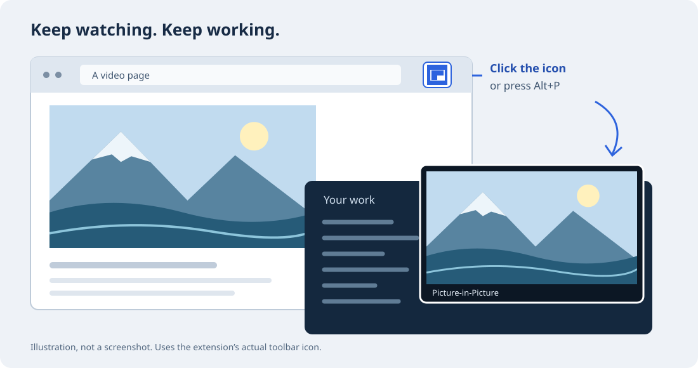

# Floating Video

A Chrome extension that puts a video in a small floating window, especially on sites that **don't offer a PiP button or disable it on their player**. Keep watching while you use another tab or app. Some browser and site restrictions still apply.



*Illustration, not a screenshot. The toolbar icon is the extension's real asset.*

## Install

No build step or package installation is needed. The extension requires desktop Chrome 106 or later; optional automatic mode needs a newer Chrome version.

1. [Download the source ZIP](https://github.com/tommyent/floating-video/archive/refs/heads/main.zip) and extract it, or clone this repository. If a [release](https://github.com/tommyent/floating-video/releases) provides `floating-video.zip`, extract that instead. No release ZIP is published yet.
2. Open `chrome://extensions` in Chrome and turn on **Developer mode**.
3. Choose **Load unpacked** and select the extracted folder containing `manifest.json`.
4. Pin **Floating Video** from Chrome's Extensions menu for easy access.

These steps follow [Chrome's unpacked-extension guide](https://developer.chrome.com/docs/extensions/get-started/tutorial/hello-world#load-unpacked). Keep the extracted folder in place. After updating its files, reload the extension and refresh the video page.

## Use

1. Start a video on the page.
2. Click the **Floating Video** toolbar icon or press **Alt+P**.
3. Use the same button or shortcut again to close PiP.

For optional automatic opening when you leave a video tab, enable **Open a playing video when I leave its tab** on the extension's settings page. It is off by default. Chrome decides which sites qualify and may ask for permission; see [Chrome's automatic PiP requirements](https://developer.chrome.com/blog/automatic-picture-in-picture-media-playback).

If the toolbar icon shows **!**, hover over it for the error message.

## Limits

- Works with playable HTML video. Chrome's protected pages and a site's Permissions Policy can prevent PiP. Clearing a player's PiP opt-out does not bypass those restrictions.
- PiP controls come from Chrome and the site. A site can report an infinite video duration, producing a **LIVE** label and no scrubbing even for recorded content. This extension does not add missing seek or next-episode controls.
- Next-episode carry-over needs a replacement video in the same document while Chrome still holds PiP open. It cannot start an episode the site failed to create or restore PiP after a full navigation.
- One Disney+ replacement transition was traced successfully while the tab was hidden. An earlier black-page failure remains unexplained. This is not a guarantee for every transition or site; details are below.

## How it works

The toolbar action and **Alt+P** are designed to toggle Picture-in-Picture for the current tab. The implementation chooses one video across accessible frames, preferring playing video, then the largest displayed area. A ready, paused video is a fallback. Open shadow roots are included; closed shadow roots are not accessible.

The settings page offers optional automatic mode, off by default. Chrome controls eligibility and permission prompts. See [Chrome's automatic PiP requirements](https://developer.chrome.com/blog/automatic-picture-in-picture-media-playback): Chrome 134+, playing audible media in the top frame, audio focus, and the site's permission/engagement requirements. Automatic mode is not guaranteed on every site. Chrome manages closing automatically opened windows when returning to the tab.

Automatic mode can replace a site's media-session PiP handler. After disabling it, reload the site to restore its own handler. It does not register a handler while disabled on a fresh page.

Next-video transfer is implemented for PiP opened by the extension, independently of automatic mode. While PiP remains active, a 250 ms watcher looks for a playing replacement when the current video ends, is removed, becomes unavailable, or is paused and hidden. Closing PiP stops the watcher. If Chrome closes PiP before the replacement is ready, this cannot reopen it without another permitted activation. Navigation and replacement across documents are not covered. Simulated tests cover these behaviors; the bounded Disney+ live result is recorded below.

The manual action temporarily clears a video's PiP opt-out attribute and restores it when the PiP window closes or the request fails (Chrome closes PiP as soon as the attribute returns). It cannot bypass Chrome's restricted pages, Permissions Policy, or other browser restrictions. Errors appear as a **!** toolbar badge with an explanation in the tooltip.

## Permissions and privacy

- `scripting` and `activeTab`: execute the toolbar action in the selected tab.
- All-site host access: retained for embedded cross-origin videos and automatic mode. Automatic-mode scripts run only in the top frame; manual selection inspects accessible frames on demand.
- `storage`: sync one boolean setting through Chrome Sync. No video content, browsing history, or analytics is collected or sent by extension code.

The extension contains no remote scripts or runtime dependencies. It uses its own icon assets.

## Development

The repository root is the unpacked extension. The local `floating-video.zip` package contains runtime files and icons; it is ignored by Git and is not a published release.

```sh
node --test
```

Tests use Node's built-in runner and simulated Chrome/DOM APIs. They cover video selection, frame targeting, PiP rejection, repeat clicks, automatic-mode settings races, unsupported APIs, settings persistence errors, and packaged asset references.

`test/next-episode.html` is a manual browser fixture for video replacement (with and without removing the old element) and source changes. Serve the repository over localhost and load the fixture in a test Chrome launched with `--mute-audio`. It creates its own short clips and logs whether PiP follows the second episode after the initial gesture expires. The fixture has not yet been run in real Chrome, including its same-element source-swap case.

The toolbar handler starts script injection immediately and uses Chrome API callbacks through frame selection and the PiP request, keeping asynchronous badge updates out of that path. Regression tests check this call ordering and API-error feedback.

**Live check (Chrome 155, Paramount+, 2026-10-13):** Alt+P opened PiP on a video that carries `disablepictureinpicture`, and the window stayed open; the attribute came back after PiP closed. Before this fix, PiP closed within 3 ms of opening. This check did not cover next-episode transfer. Automatic mode and the settings accessibility tree remain unverified. The test suite establishes simulated logic results, not those browser outcomes.

**Disney+ next-episode check (2026-11-01, 10:42–10:43 UTC):** One successful transition was captured with the extension loaded while the tab was hidden. The old video ended and was removed; the document retained its PiP association across an in-page route change and a brief gap with no video. The replacement fired `playing` at 10:43:37.703 and entered PiP at 10:43:37.706. This is consistent with the transfer watcher, but the trace does not identify the caller of the PiP request. An earlier run around 04:40 local time left a black page; a later snapshot found no accessible video or document PiP element. That failure remains unexplained. The successful trace does not establish reliable operation on every Disney+ transition or other streaming sites.
